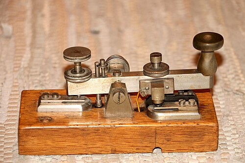
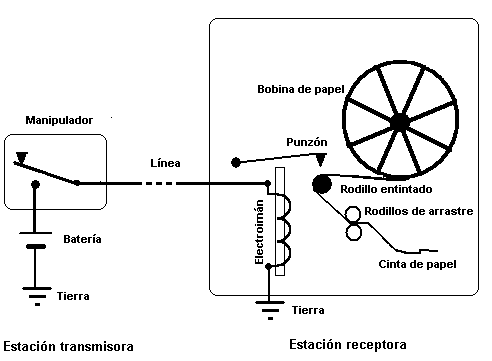
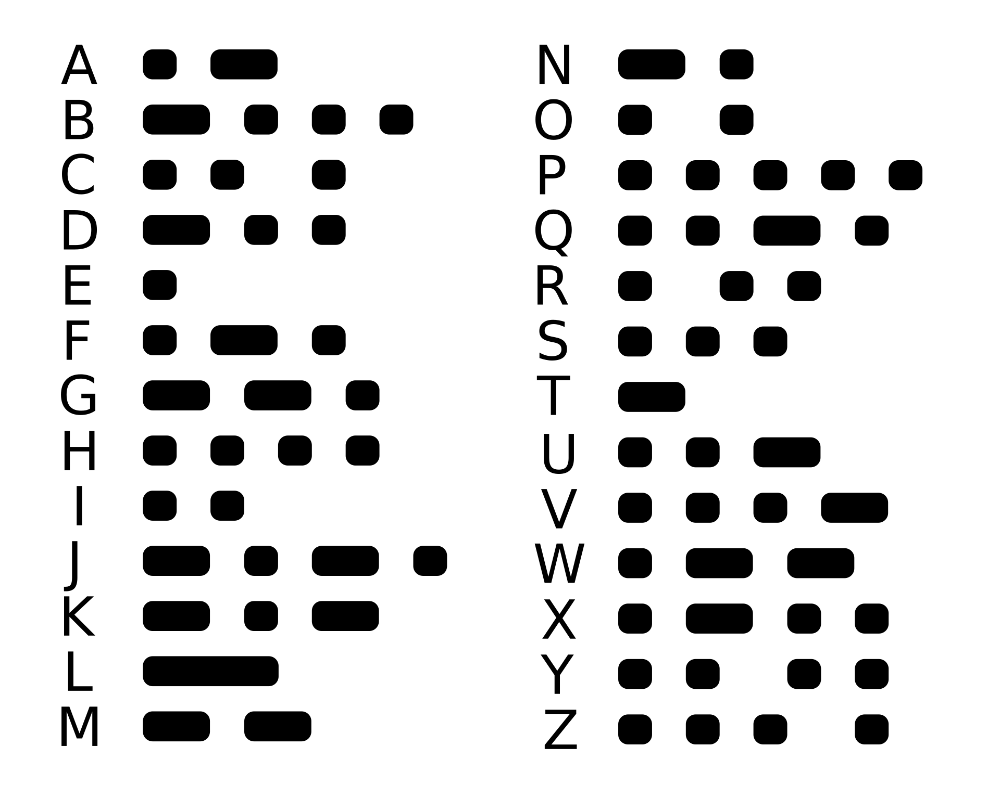
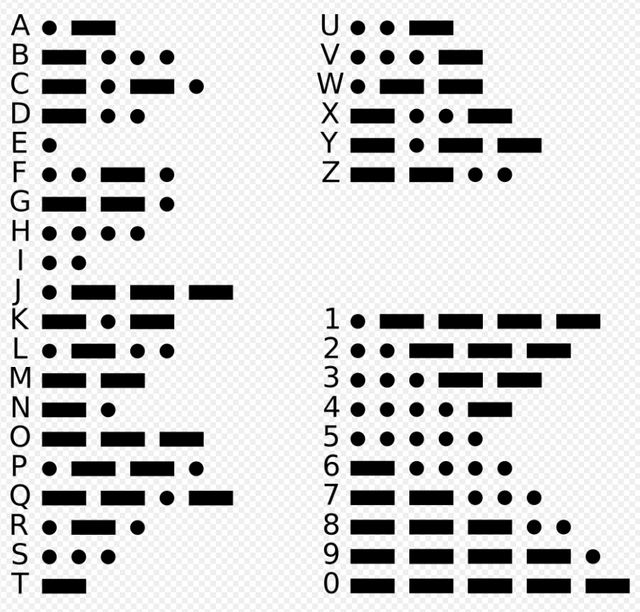
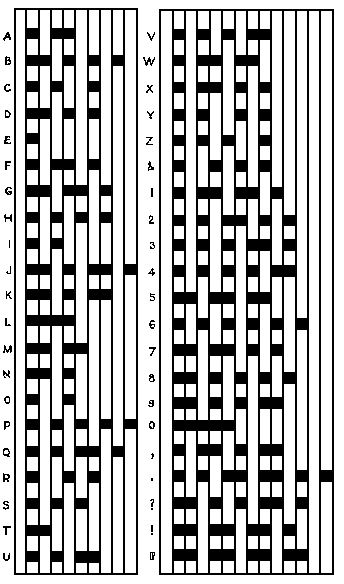
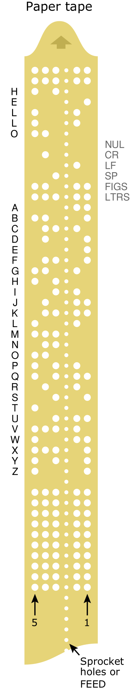

# Markdown – syntaks og tegnkodning

Opdateret 15. oktober 2026 · Version 2.0.1

## Indhold

- [[#Hvorfor bruge Markdown?]]
- [[#Hvad er Markdown?]]
- [[#Grundlæggende syntaks]]
  - [[#Overskrifter – Headings]]
  - [[#Fed skrift – Bold]]
  - [[#Kursiv – Italic]]
  - [[#Citatblok – Blockquote]]
  - [[#Nummereret liste – Ordered List]]
  - [[#Unummereret liste – Unordered List]]
  - [[#Kode i en tekstlinje – Inline Code]]
  - [[#Afgrænset kodeblok – Fenced Code Block]]
  - [[#Vandret skillelinje – Horizontal Rule]]
  - [[#Links]]
  - [[#Billeder]]
- [[#Udvidet syntaks og HTML]]
  - [[#Tabel – Table]]
  - [[#Fodnote – Footnote]]
  - [[#ID på en overskrift – Heading ID]]
  - [[#Definitionsliste – Definition List]]
  - [[#Gennemstreget tekst – Strikethrough]]
  - [[#Opgaveliste – Task List]]
  - [[#Emoji]]
  - [[#Fremhævning i Obsidian]]
  - [[#Fremhævning i Visual Studio Code]]
  - [[#Sænket skrift – Subscript]]
  - [[#Hævet skrift – Superscript]]
  - [[#Markeret tekst med HTML]]
  - [[#Sideskift ved eksport]]
- [[#Lidt historie]]
- [[#Fjernskrivere og telex]]
- [[#ITA2 – en 5-bit-tegnkodning]]
- [[#ASCII – en 7-bit-tegnkodning]]
  - [[#ASCII-kontroltegn – kode 0–31 og 127]]
  - [[#Udskrivbare ASCII-tegn – kode 32–126]]
- [[#8-bit-codepages og udvidet ASCII]]
  - [[#Windows-1252]]
  - [[#Fra codepages til Unicode]]
- [[#Præsentation og filformater]]
- [[#Kildehenvisninger]]

Indholdsfortegnelsen og links tilbage til den bruger **Obsidian-wikilinks**, eksempelvis `[[#Indhold]]`. De kræver en renderer, der understøtter denne syntaks. Almindelige Markdown-links til overskrifter kan bruges i stedet, men overskriftens linkmål afhænger af rendereren.

## Hvorfor bruge Markdown?

[[#Indhold]]
[Indhold](#Indhold)
Dette dokument giver en generel introduktion til **Markdown (`filnavn.md`)** og kan bruges som opslagsværk i undervisningen.

---
_Defnition:_ UTF-8
> UTF-8 er en tegnkodning, der bruges til at repræsentere Unicode-tegn som bytes.

**UTF-8 bliver ofte kaldt et tegnsæt, men er en tegnkodning**.

Forskellen er:
- **Et tegnsæt** beskriver, hvilke tegn der findes i en samling.
- **Unicode** definerer tegn og tildeler dem kodepunkter.
- **UTF-8** bestemmer, hvordan disse kodepunkter repræsenteres som bytes.

Eksempel: Bogstavet **æ** har Unicode-kodepunktet `U+00E6`. Med UTF-8 repræsenteres det af de to bytes `C3 A6` i hexadecimal notation.

| Hexadecimalt | Binært                |
| ------------ | --------------------- |
| `C3 A6`      | `1100.0011 1010.0110` |

> UTF-8 er en tegnkodning, der bruges til at repræsentere Unicode-tegn som bytes.

Forvirringen opstår bl.a. udfra at i HTML skrives eksempelvis `<meta charset="UTF-8">`, selv om det, man angiver, er tegnkodningen.

---

En Markdown-fil er en almindelig tekstfil, hvor tegn som `#`, `*` og `-` bruges til at angive struktur og formatering. Filendelsen er normalt `.md`. Gem gerne filen som **UTF-8**, så blandt andet danske bogstaver kan repræsenteres.

Dokumentet er ikke udtømmende. Først gennemgås syntaksen. Derefter forklares den historiske sammenhæng mellem telegrafi, tegnkodning og præsentation af tekst.

## Hvad er Markdown?

[[#Indhold]]

Markdown er et letvægts-markupformat, der gør det muligt at tilføje struktur og enkel formatering til almindelig tekst.

En væsentlig idé bag Markdown er, at dokumentet fortsat skal være forholdsvis let at læse, selv når man ser den rå Markdown-kilde.

Markdown blev introduceret af John Gruber i 2004 med bidrag fra Aaron Swartz.

Der findes forskellige **Markdown-varianter og renderere**. En renderer fortolker teksten og fremstiller den formaterede visning. Derfor fungerer ikke al syntaks ens i eksempelvis Obsidian, Visual Studio Code, GitHub og GitLab.

**CommonMark** beskriver en fælles kernesyntaks. **GitHub Flavored Markdown (GFM)** bygger videre på CommonMark med blandt andet tabeller, gennemstregning og opgavelister. Programmer kan understøtte yderligere funktioner.

Opdelingen i grundlæggende og udvidet syntaks nedenfor er praktisk. Den er ikke en opdeling i to universelle Markdown-standarder. Afgrænsede kodeblokke er eksempelvis med i CommonMark, selv om de nogle gange kaldes en udvidelse af den oprindelige Markdown-syntaks.

## Grundlæggende syntaks

[[#Indhold]]

Følgende elementer understøttes bredt. Benævnelserne er ofte på engelsk. Eksemplerne viser syntaksen som kode, så markeringerne også kan ses i en formateret visning.

### Overskrifter – Headings

[[#Indhold]]

Markdown understøtter seks overskriftsniveauer. Skriv et mellemrum efter `#`-tegnene:

```markdown
# Overskrift på niveau 1
## Overskrift på niveau 2
### Overskrift på niveau 3
#### Overskrift på niveau 4
##### Overskrift på niveau 5
###### Overskrift på niveau 6
```

Brug niveauerne til at vise dokumentets struktur. En underoverskrift bør passe ind under den overskrift, den hører til.

### Fed skrift – Bold

[[#Indhold]]

Syntaks: `**fed tekst**`

Resultat: **fed tekst**

### Kursiv – Italic

[[#Indhold]]

Syntaks: `*kursiv tekst*`

Resultat: *kursiv tekst*

### Citatblok – Blockquote

[[#Indhold]]

```markdown
> Dette er et citat.
```

> Dette er et citat.

### Nummereret liste – Ordered List

[[#Indhold]]

```markdown
1. Første element
2. Andet element
3. Tredje element
```

1. Første element
2. Andet element
3. Tredje element

### Unummereret liste – Unordered List

[[#Indhold]]

```markdown
- Første element
- Andet element
- Tredje element
```

- Første element
- Andet element
- Tredje element

### Kode i en tekstlinje – Inline Code

[[#Indhold]]

Sæt en backtick på hver side af teksten:

```markdown
Gem dokumentet som `filnavn.md`.
```

Resultat: Gem dokumentet som `filnavn.md`.

Backticks er særligt nyttige til filnavne, kommandoer og korte kodeeksempler.

### Kode i en tekstlinje – Inline Code med Placeholder notation

[[#Indhold]]

Sæt en `< og >`  på hver side af teksten:

```markdown
Gem dokumentet som <filnavn>.md`.
```

Resultat: Gem dokumentet som `filnavn.md`.

Placeholder notation er særligt nyttige til filnavne, kommandoer og korte kodeeksempler.

| Sammenhæng                         | Eksempel                    | Betydning                                                                |
| ---------------------------------- | --------------------------- | ------------------------------------------------------------------------ |
| Filnavne i dokumentation           | `<filnavn>.md`              | Erstat `<filnavn>` med det ønskede navn.                                 |
| Kommandoer i vejledninger          | `ssh <brugernavn>@<server>` | Indsæt dit brugernavn og serverens navn eller IP-adresse.                |
| HTML og XML                        | `<titel>Min tekst</titel>`  | Afgrænser tags. Her er vinkelparenteserne en nødvendig del af syntaksen. |
| Generiske typer i eksempelvis Java | `List<String>`              | Angiver, at listen indeholder værdier af typen `String`.                 |
| Markdown-links                     | `<https://example.com>`     | Markerer en adresse som et automatisk link.                              |
| Matematiske sammenligninger        | `3 < 5` og `8 > 2`          | Tegnene betyder henholdsvis »mindre end« og »større end«.                |

I kommandovejledninger møder du også ofte denne konvention:

- **`<værdi>`**: En værdi, du skal indsætte.
- **`[argument]`**: Noget, der er valgfrit.

Konventionerne varierer, så vejledningens egen forklaring gælder.

### Afgrænset kodeblok – Fenced Code Block

[[#Indhold]]

En kodeblok kan afgrænses med tre backticks. Angiv eventuelt sproget eller dataformatet efter de første tre backticks:

````markdown
```json
{
  "firstName": "John",
  "lastName": "Smith",
  "age": 25
}
```
````

Det viste indhold er gyldig **JSON**, som er et dataformat. Markeringen `json` giver rendereren mulighed for at farvelægge syntaksen. Farvelægning afhænger af programmet og dets understøttelse af formatet.

### Vandret skillelinje – Horizontal Rule

[[#Indhold]]

Skriv mindst tre bindestreger på en separat linje. Brug en tom linje før og efter, så eksemplet er tydeligt afgrænset:

```markdown
Tekst før skillelinjen.

---

Tekst efter skillelinjen.
```

---

### Links

[[#Indhold]]

```markdown
[Markdown Guide](https://www.markdownguide.org)
```

Resultat: [Markdown Guide](https://www.markdownguide.org)

### Billeder

[[#Indhold]]

```markdown

```


Teksten i de firkantede parenteser er billedets alternative tekst. Stien i parenteserne angiver billedfilens placering. I eksemplet ligger filen i undermappen `Attachments` ved siden af Markdown-filen.

**Skalering i Obsidian**

```markdown
![[Morsetaste.jpg|300]]
```

I Obsidian angiver `300` billedets bredde i pixels, mens proportionerne bevares. Billedfilen skal kunne findes i din vault. Denne indlejring er Obsidian-syntaks og ikke CommonMark.

**Skalering i Visual Studio Code**

Udvidelsen [Markdown Image Size](https://marketplace.visualstudio.com/items?itemName=bierner.markdown-image-size) tilføjer følgende syntaks til VS Codes indbyggede Markdown-forhåndsvisning:

```markdown

```

Her angives bredden til 250 pixels, og højden tilpasses forholdsmæssigt. Denne syntaks kræver understøttelse fra en udvidelse eller renderer; den er ikke en del af CommonMark.

## Udvidet syntaks og HTML

[[#Indhold]]

Følgende muligheder afhænger af Markdown-varianten eller programmet. HTML kan bruges i mange renderere, men tilladte elementer, attributter og CSS varierer. Understøttelse af eksempelvis `<sub>` betyder ikke nødvendigvis, at alle HTML-styles tillades.

### Tabel – Table

[[#Indhold]]

Tabeller med lodrette streger understøttes blandt andet af GFM og Obsidian:

```markdown
| Syntaks | Beskrivelse |
| ------- | ----------- |
| Header | Overskrift |
| Paragraph | Afsnit |
```

| Syntaks | Beskrivelse |
| ------- | ----------- |
| Header | Overskrift |
| Paragraph | Afsnit |

Hvis en celle skal indeholde selve tegnet `|`, skrives det som `\|` i tabellens kilde. HTML-tegnreferencer, der skal vises som kode, skal stå mellem backticks, eksempelvis `&amp;`.

### Fodnote – Footnote

[[#Indhold]]

Fodnoter understøttes blandt andet af Obsidian og flere andre Markdown-miljøer, men er ikke en del af CommonMarks kernesyntaks:

```markdown
Her er en sætning med en fodnote.[^1]

[^1]: Dette er fodnoten.
```

Her er en sætning med en fodnote.[^1]

[^1]: Dette er fodnoten.

### ID på en overskrift – Heading ID

[[#Indhold]]

Nogle renderere, eksempelvis Pandoc med den relevante udvidelse, understøtter et eksplicit ID på en overskrift:

```markdown
### Min overskrift {#custom-id}

[Gå til overskriften](#custom-id)
```

Syntaksen `{#custom-id}` understøttes ikke universelt. Mange programmer opretter i stedet automatisk linkmål ud fra overskriftsteksten. Brug programmets funktion til at kopiere overskriftslinket, hvis du er i tvivl.

### Definitionsliste – Definition List

[[#Indhold]]

Nogle renderere, eksempelvis Pandoc med den relevante udvidelse, understøtter definitionslister:

```markdown
Begreb
: Forklaring af begrebet.
```

Dette er ikke CommonMark- eller GFM-kernesyntaks. Kontroller, om din renderer understøtter det.

### Gennemstreget tekst – Strikethrough

[[#Indhold]]

Syntaks: `~~Denne tekst er gennemstreget.~~`

Resultat i en renderer med understøttelse: ~~Denne tekst er gennemstreget.~~

Gennemstregning understøttes blandt andet af GFM og Obsidian.

### Opgaveliste – Task List

[[#Indhold]]

```markdown
- [x] Opret dokumentet
- [ ] Kontroller indholdet
- [ ] Del dokumentet
```

- [x] Opret dokumentet
- [ ] Kontroller indholdet
- [ ] Del dokumentet

Opgavelister understøttes blandt andet af GFM og Obsidian. Om afkrydsningsfelterne kan ændres direkte i visningen, afhænger af programmet.

### Emoji

[[#Indhold]]

Du kan indsætte et emoji direkte som tekst: 😂

Det kræver ikke særlig Markdown-syntaks. Visningen afhænger blandt andet af skrifttype og platform. Kortkoder som `:smile:` kræver særskilt understøttelse.

### Fremhævning i Obsidian

[[#Indhold]]

Syntaks: `Dette er ==vigtige ord==.`

I Obsidian fremhæves ordene mellem de dobbelte lighedstegn. Syntaksen er ikke en del af CommonMark.

### Fremhævning i Visual Studio Code

[[#Indhold]]

Udvidelsen [Mark Highlighter](https://marketplace.visualstudio.com/items?itemName=DaCodeKid.vscode-mark-highlighter) kan fremhæve `==markeret tekst==` i **kodeeditoren**.

Fremhævning i editoren og fremhævning i Markdown-forhåndsvisningen er to forskellige funktioner. Udvidelsens dokumentation beskriver editoren; fremhævning i forhåndsvisningen kræver, at den anvendte renderer eller en anden udvidelse understøtter syntaksen.

### Sænket skrift – Subscript

[[#Indhold]]

I renderere, som tillader de relevante HTML-elementer, kan du skrive:

```html
H<sub>2</sub>O
```

Resultat: H<sub>2</sub>O.

### Hævet skrift – Superscript

[[#Indhold]]

```html
x<sup>2</sup>
```

Resultat i en renderer med HTML-understøttelse: x<sup>2</sup>.

### Markeret tekst med HTML

[[#Indhold]]

Hvis rendereren tillader HTML og inline-CSS, kan tekstfarve og baggrund eksempelvis angives sådan:

```html
<span style="background-color: #FFFF00; color: #000000;">Markeret tekst</span>
<span style="background-color: #FF0000; color: #FFFFFF;">Markeret tekst</span>
```

Det forældede `<font>`-element bør ikke bruges. Brug CSS som i eksemplet. Farverne kan blive fjernet af renderere, som filtrerer HTML-attributter.

### Sideskift ved eksport

[[#Indhold]]

Markdown har ikke en universel sideskiftkommando. Ved udskrivning eller PDF-eksport fra en HTML-baseret renderer kan følgende virke, hvis programmet tillader HTML og respekterer CSS-reglen:

```html
<div style="break-after: page;"></div>
```

Indsæt en tom linje efter HTML-blokken, før du fortsætter med Markdown. Sideskiftet afhænger af eksportværktøjet og ses ikke nødvendigvis i en almindelig skærmvisning.

<div style="break-after: page;"></div>

## Lidt historie

[[#Indhold]]

Udveksling af information elektronisk er ikke så enkelt, som man umiddelbart skulle tro.

Et vigtigt skridt mod standardiseret elektronisk kommunikation blev taget med udviklingen af den elektriske telegraf og morsekoden i 1800-tallet. I 1844 demonstrerede Samuel Morse og Alfred Vail en telegrafforbindelse mellem Washington D.C. og Baltimore.

For at sende information blev der anvendt en telegraf.



Illustration fra det oprindelige materiale; kildeangivelse: Wikipedia.

Telegrafen fungerer ved, at et elektrisk kredsløb sluttes, når telegraftasten trykkes ned. Dermed løber der strøm gennem en elektromagnet.

Strømmen gennem spolens viklinger skaber et magnetfelt, som kan påvirke en mekanisk del i modtageren. På de tidlige registrerende telegrafer kunne denne bevægelse bruges til at lave mærker på en papirstrimmel.

Da papirstrimlen blev fremført med en konstant hastighed, kunne længden af signalerne registreres som henholdsvis korte og lange signaler.

[Video om telegraf](https://www.youtube.com/shorts/9DCP4TMYg_M)

Som det ses af illustrationerne herunder, var tidsintervallet mellem signalerne en vigtig del af den amerikanske morsekode.

Den internationale morsekode standardiserede senere forholdet mellem signalernes længder. En prik (_dit_) udgør én tidsenhed, mens en streg (_dah_) udgør tre tidsenheder. Mellemrummene mellem signaler, bogstaver og ord defineres ligeledes i tidsenheder.

| Amerikansk morsekode omkring 1844                                                            | International morsekode – standardiseret fra 1865                                                                            |
| --------------------------------------------------------------------------------------- | ---------------------------------------------------------------------------------------------------------- |
|                         |                                           |
|                                                  |                                                                                                            |
| Signaltiming:<br><br>Amerikansk morsekode anvendte også særlige mellemrum inde i visse tegn. | Signaltiming (enheder):<br><br>1. Længden af en prik er en enhed (unit).<br>2. En streg svarer til tre enheder |

Kilder: Wikipedia og [ITU om standardiseringen i 1865](https://www.itu.int/en/history/Pages/ITUBorn1865.aspx).

Morsekoderne tog primært udgangspunkt i det latinske alfabet, og derfor opstod der behov for at repræsentere yderligere nationale tegn.

I Danmark anvender vi eksempelvis bogstaverne `æ`, `ø` og `å`. I forskellige kommunikationssystemer har sådanne tegn derfor enten fået egne repræsentationer eller været omskrevet, eksempelvis som `ae`, `oe` og `aa`.

Andre lande stod over for tilsvarende problemer.

Dette illustrerer et grundlæggende problem, som fortsat er relevant i moderne IT: **Hvordan sikrer vi, at afsender og modtager fortolker de samme bit som de samme tegn?**

Det er netop dette problem, som tegnkodninger forsøger at løse.

## Fjernskrivere og telex

[[#Indhold]]

[Video om en fjernskriver](https://youtu.be/KrzJqC_RtSU?t=50)

En **fjernskriver** er et apparat, som sender og modtager tekst. **Telex** er en netværkstjeneste, der forbinder fjernskrivere, så abonnenter kan sende beskeder til hinanden. Telex blev udviklet med udgangspunkt i teleprinterteknologi. Udviklingen af det automatiske telexsystem begyndte i Tyskland i 1920'erne, og en offentlig telexservice blev sat i drift i 1933.

En væsentlig fordel ved systemet var, at en besked kunne forberedes på forhånd på en perforeret papirstrimmel. Maskinen kunne derefter læse strimlen og transmittere beskeden automatisk.

Traditionel telexkommunikation fungerede typisk med en signalhastighed på **50 baud**. Baud angiver antallet af signalenheder pr. sekund. Med én startbit, fem databits og en stopperiode på 1,5 bitperioder bliver det cirka 400 tegn pr. minut. Regnet som fem bogstaver og et mellemrum pr. ord svarer det til cirka **66 ord pr. minut** før eventuelt ekstra tidsforbrug til blandt andet kontroltegn. Tallet er derfor et omtrentligt mål under bestemte forudsætninger.

Det optimerede anvendelsen af forbindelsen, fordi operatøren ikke behøvede at skrive hele beskeden manuelt, mens forbindelsen var optaget.

Tankegangen er stadig relevant i moderne datakommunikation: transmissionskapacitet er en begrænset ressource, og vi ønsker derfor at udnytte forbindelser og båndbredde så effektivt som muligt.

## ITA2 – en 5-bit-tegnkodning

[[#Indhold]]

[Video om en fjernskriver med klokkesignal](https://www.youtube.com/shorts/C2GdPW10leE)

ITA2 står for **International Telegraph Alphabet No. 2**.

ITA2 anvender en **5-bit-kode**, hvilket giver: `2^5 = 32` mulige bitkombinationer.

32 kombinationer er ikke nok til både alfabetet, cifre, tegn og kontrolfunktioner. Derfor anvender ITA2 to tilstande:

- `LTRS` – Letters
- `FIGS` – Figures

Den samme bitkombination kan dermed have forskellig betydning afhængigt af, om systemet befinder sig i Letters- eller Figures-tilstand.

Tabellen følger den internationale tildeling i [ITU-T S.1](https://www.itu.int/rec/T-REC-S.1-199303-I/en). F, G og H har ikke én fælles international Figures-værdi; disse positioner kan anvendes nationalt eller privat.

**DEC** er den numeriske værdi af bitmønstret, ikke standardens alfabetisk ordnede kombinationsnummer. **BIN** viser den mest betydende bit til venstre; ved den serielle overførsel sendes kodeelement 1, den mindst betydende bit, først. Kontrolfunktioner som CR og LF gælder i begge tilstande.

| DEC | Letters | Figures        | HEX | BIN     | Bemærkning                                         |
| --- | ------- | -------------- | --- | ------- | -------------------------------------------------- |
| 0   | `NUL`   | `NUL`          | 00  | `00000` | Nul-kombination; ingen huller i de fem datakanaler |
| 1   | `E`     | `3`            | 01  | `00001` |                                                    |
| 2   | `LF`    | `LF`           | 02  | `00010` | Line feed – linjefremføring                        |
| 3   | `A`     | `-`            | 03  | `00011` |                                                    |
| 4   | `SP`    | `SP`           | 04  | `00100` | Mellemrum                                          |
| 5   | `S`     | `'`            | 05  | `00101` |                                                    |
| 6   | `I`     | `8`            | 06  | `00110` |                                                    |
| 7   | `U`     | `7`            | 07  | `00111` |                                                    |
| 8   | `CR`    | `CR`           | 08  | `01000` | Carriage return – retur til linjestart             |
| 9   | `D`     | `WRU`          | 09  | `01001` | WRU – Who are you? Aktiverer modpartens svarsender |
| 10  | `R`     | `4`            | 0A  | `01010` |                                                    |
| 11  | `J`     | `BEL`          | 0B  | `01011` | Klokkesignal                                       |
| 12  | `N`     | `,`            | 0C  | `01100` |                                                    |
| 13  | `F`     | Nationalt valg | 0D  | `01101` | National eller privat anvendelse                   |
| 14  | `C`     | `:`            | 0E  | `01110` |                                                    |
| 15  | `K`     | `(`            | 0F  | `01111` |                                                    |
| 16  | `T`     | `5`            | 10  | `10000` |                                                    |
| 17  | `Z`     | `+`            | 11  | `10001` |                                                    |
| 18  | `L`     | `)`            | 12  | `10010` |                                                    |
| 19  | `W`     | `2`            | 13  | `10011` |                                                    |
| 20  | `H`     | Nationalt valg | 14  | `10100` | National eller privat anvendelse                   |
| 21  | `Y`     | `6`            | 15  | `10101` |                                                    |
| 22  | `P`     | `0`            | 16  | `10110` |                                                    |
| 23  | `Q`     | `1`            | 17  | `10111` |                                                    |
| 24  | `O`     | `9`            | 18  | `11000` |                                                    |
| 25  | `B`     | `?`            | 19  | `11001` |                                                    |
| 26  | `G`     | Nationalt valg | 1A  | `11010` | National eller privat anvendelse                   |
| 27  | `FIGS`  | `FIGS`         | 1B  | `11011` | Skift til Figures-tilstand                         |
| 28  | `M`     | `.`            | 1C  | `11100` |                                                    |
| 29  | `X`     | `/`            | 1D  | `11101` |                                                    |
| 30  | `V`     | `=`            | 1E  | `11110` |                                                    |
| 31  | `LTRS`  | `LTRS`         | 1F  | `11111` | Skift til Letters-tilstand                         |



Illustration: Crypto Museum. Illustrationer og ældre oversigter kan vise nationale eller historiske varianter; den internationale tildeling i tabellen ovenfor følger ITU-T S.1.

ITA2 er et godt eksempel på en tidlig tegnkodning, hvor et bestemt bitmønster repræsenterer et tegn eller en kontrolfunktion.

## ASCII – en 7-bit-tegnkodning

[[#Indhold]]

Senere opstod behovet for en tegnkodning med plads til flere tegn og kontrolfunktioner. En vigtig standard blev **ASCII**, som står for **American Standard Code for Information Interchange**.

ASCII er en **7-bit-tegnkodning**. 

Med 7 bit kan der dannes: `2^7 = 128` forskellige bitkombinationer.

ASCII indeholder derfor koder fra **0 til 127**.

### ASCII-kontroltegn – kode 0–31 og 127

[[#Indhold]]

ASCII indeholder kontroltegn, som oprindeligt blev anvendt til blandt andet terminaler, fjernskrivere og kommunikationsudstyr.

Koderne **0–31** og **127** er kontroltegn. Eksempler er `NUL` (Null), `BEL` (Bell), `BS` (Backspace), `LF` (Line Feed), `CR` (Carriage Return), `ESC` (Escape) og `DEL` (Delete).

Tabellen bruger syv binære cifre. **DEC**, **OCT**, **HEX** og **BIN** betyder henholdsvis decimal, oktal, hexadecimal og binær notation. Kontroltegnene beskriver funktioner; de er ikke almindelige udskrivbare symboler. De vises derfor med forkortelser.

| DEC | OCT | HEX | BIN       | Symbol | Beskrivelse                 |
| --- | --- | --- | --------- | ------ | --------------------------- |
| 0   | 000 | 00  | `0000000` | `NUL`  | Null character              |
| 1   | 001 | 01  | `0000001` | `SOH`  | Start of Heading            |
| 2   | 002 | 02  | `0000010` | `STX`  | Start of Text               |
| 3   | 003 | 03  | `0000011` | `ETX`  | End of Text                 |
| 4   | 004 | 04  | `0000100` | `EOT`  | End of Transmission         |
| 5   | 005 | 05  | `0000101` | `ENQ`  | Enquiry                     |
| 6   | 006 | 06  | `0000110` | `ACK`  | Acknowledge                 |
| 7   | 007 | 07  | `0000111` | `BEL`  | Bell, Alert                 |
| 8   | 010 | 08  | `0001000` | `BS`   | Backspace                   |
| 9   | 011 | 09  | `0001001` | `HT`   | Horizontal Tab              |
| 10  | 012 | 0A  | `0001010` | `LF`   | Line Feed                   |
| 11  | 013 | 0B  | `0001011` | `VT`   | Vertical Tabulation         |
| 12  | 014 | 0C  | `0001100` | `FF`   | Form Feed                   |
| 13  | 015 | 0D  | `0001101` | `CR`   | Carriage Return             |
| 14  | 016 | 0E  | `0001110` | `SO`   | Shift Out                   |
| 15  | 017 | 0F  | `0001111` | `SI`   | Shift In                    |
| 16  | 020 | 10  | `0010000` | `DLE`  | Data Link Escape            |
| 17  | 021 | 11  | `0010001` | `DC1`  | Device Control One (XON)    |
| 18  | 022 | 12  | `0010010` | `DC2`  | Device Control Two          |
| 19  | 023 | 13  | `0010011` | `DC3`  | Device Control Three (XOFF) |
| 20  | 024 | 14  | `0010100` | `DC4`  | Device Control Four         |
| 21  | 025 | 15  | `0010101` | `NAK`  | Negative Acknowledge        |
| 22  | 026 | 16  | `0010110` | `SYN`  | Synchronous Idle            |
| 23  | 027 | 17  | `0010111` | `ETB`  | End of Transmission Block   |
| 24  | 030 | 18  | `0011000` | `CAN`  | Cancel                      |
| 25  | 031 | 19  | `0011001` | `EM`   | End of medium               |
| 26  | 032 | 1A  | `0011010` | `SUB`  | Substitute                  |
| 27  | 033 | 1B  | `0011011` | `ESC`  | Escape                      |
| 28  | 034 | 1C  | `0011100` | `FS`   | File Separator              |
| 29  | 035 | 1D  | `0011101` | `GS`   | Group Separator             |
| 30  | 036 | 1E  | `0011110` | `RS`   | Record Separator            |
| 31  | 037 | 1F  | `0011111` | `US`   | Unit Separator              |
| 127 | 177 | 7F  | `1111111` | `DEL`  | Delete                      |

### Udskrivbare ASCII-tegn – kode 32–126

[[#Indhold]]

ASCII-koderne **32–126** er de udskrivbare tegn, inklusive mellemrum. De omfatter cifrene `0–9`, bogstaverne `A–Z` og `a–z` samt tegnsætning og andre symboler. Kode **127** er kontroltegnet `DEL` og er derfor placeret i den foregående tabel.

Eksempel:

```text
A = decimal 65
A = hexadecimal 41
A = binær 1000001
```

Som en byte på otte bit kan samme værdi skrives `01000001`. Det ekstra indledende nul ændrer ikke værdien.

**HTML-talreferencer henviser til Unicode-kodepunkter.** For ASCII-tegnene er kodepunktets talværdi den samme som ASCII-værdien. Eksempelvis betyder `&#65;` tegnet `A`. En navngiven reference som `&amp;` betegner `&`. En streg i kolonnen for navngivne referencer betyder, at tabellen ikke angiver en navngiven reference for tegnet. Referencerne står som kode, så syntaksen kan læses.

| DEC | OCT | HEX | BIN       | Symbol  | HTML-talreference | HTML-navnereference | Beskrivelse                            |
| --- | --- | --- | --------- | ------- | ----------------- | ------------------- | -------------------------------------- |
| 32  | 040 | 20  | `0100000` | `SP`    | `&#32;`           | —                   | Space                                  |
| 33  | 041 | 21  | `0100001` | `!`     | `&#33;`           | `&excl;`            | Exclamation mark                       |
| 34  | 042 | 22  | `0100010` | `"`     | `&#34;`           | `&quot;`            | Double quotes (or speech marks)        |
| 35  | 043 | 23  | `0100011` | `#`     | `&#35;`           | `&num;`             | Number sign                            |
| 36  | 044 | 24  | `0100100` | `$`     | `&#36;`           | `&dollar;`          | Dollar                                 |
| 37  | 045 | 25  | `0100101` | `%`     | `&#37;`           | `&percnt;`          | Per cent sign                          |
| 38  | 046 | 26  | `0100110` | `&`     | `&#38;`           | `&amp;`             | Ampersand                              |
| 39  | 047 | 27  | `0100111` | `'`     | `&#39;`           | `&apos;`            | Single quote                           |
| 40  | 050 | 28  | `0101000` | `(`     | `&#40;`           | `&lpar;`            | Open parenthesis (or open bracket)     |
| 41  | 051 | 29  | `0101001` | `)`     | `&#41;`           | `&rpar;`            | Close parenthesis (or close bracket)   |
| 42  | 052 | 2A  | `0101010` | `*`     | `&#42;`           | `&ast;`             | Asterisk                               |
| 43  | 053 | 2B  | `0101011` | `+`     | `&#43;`           | `&plus;`            | Plus                                   |
| 44  | 054 | 2C  | `0101100` | `,`     | `&#44;`           | `&comma;`           | Comma                                  |
| 45  | 055 | 2D  | `0101101` | `-`     | `&#45;`           | —                   | Hyphen-minus                           |
| 46  | 056 | 2E  | `0101110` | `.`     | `&#46;`           | `&period;`          | Period, dot or full stop               |
| 47  | 057 | 2F  | `0101111` | `/`     | `&#47;`           | `&sol;`             | Slash or divide                        |
| 48  | 060 | 30  | `0110000` | `0`     | `&#48;`           | —                   | Zero                                   |
| 49  | 061 | 31  | `0110001` | `1`     | `&#49;`           | —                   | One                                    |
| 50  | 062 | 32  | `0110010` | `2`     | `&#50;`           | —                   | Two                                    |
| 51  | 063 | 33  | `0110011` | `3`     | `&#51;`           | —                   | Three                                  |
| 52  | 064 | 34  | `0110100` | `4`     | `&#52;`           | —                   | Four                                   |
| 53  | 065 | 35  | `0110101` | `5`     | `&#53;`           | —                   | Five                                   |
| 54  | 066 | 36  | `0110110` | `6`     | `&#54;`           | —                   | Six                                    |
| 55  | 067 | 37  | `0110111` | `7`     | `&#55;`           | —                   | Seven                                  |
| 56  | 070 | 38  | `0111000` | `8`     | `&#56;`           | —                   | Eight                                  |
| 57  | 071 | 39  | `0111001` | `9`     | `&#57;`           | —                   | Nine                                   |
| 58  | 072 | 3A  | `0111010` | `:`     | `&#58;`           | `&colon;`           | Colon                                  |
| 59  | 073 | 3B  | `0111011` | `;`     | `&#59;`           | `&semi;`            | Semicolon                              |
| 60  | 074 | 3C  | `0111100` | `<`     | `&#60;`           | `&lt;`              | Less than (or open angled bracket)     |
| 61  | 075 | 3D  | `0111101` | `=`     | `&#61;`           | `&equals;`          | Equals                                 |
| 62  | 076 | 3E  | `0111110` | `>`     | `&#62;`           | `&gt;`              | Greater than (or close angled bracket) |
| 63  | 077 | 3F  | `0111111` | `?`     | `&#63;`           | `&quest;`           | Question mark                          |
| 64  | 100 | 40  | `1000000` | `@`     | `&#64;`           | `&commat;`          | At sign                                |
| 65  | 101 | 41  | `1000001` | `A`     | `&#65;`           | —                   | Uppercase A                            |
| 66  | 102 | 42  | `1000010` | `B`     | `&#66;`           | —                   | Uppercase B                            |
| 67  | 103 | 43  | `1000011` | `C`     | `&#67;`           | —                   | Uppercase C                            |
| 68  | 104 | 44  | `1000100` | `D`     | `&#68;`           | —                   | Uppercase D                            |
| 69  | 105 | 45  | `1000101` | `E`     | `&#69;`           | —                   | Uppercase E                            |
| 70  | 106 | 46  | `1000110` | `F`     | `&#70;`           | —                   | Uppercase F                            |
| 71  | 107 | 47  | `1000111` | `G`     | `&#71;`           | —                   | Uppercase G                            |
| 72  | 110 | 48  | `1001000` | `H`     | `&#72;`           | —                   | Uppercase H                            |
| 73  | 111 | 49  | `1001001` | `I`     | `&#73;`           | —                   | Uppercase I                            |
| 74  | 112 | 4A  | `1001010` | `J`     | `&#74;`           | —                   | Uppercase J                            |
| 75  | 113 | 4B  | `1001011` | `K`     | `&#75;`           | —                   | Uppercase K                            |
| 76  | 114 | 4C  | `1001100` | `L`     | `&#76;`           | —                   | Uppercase L                            |
| 77  | 115 | 4D  | `1001101` | `M`     | `&#77;`           | —                   | Uppercase M                            |
| 78  | 116 | 4E  | `1001110` | `N`     | `&#78;`           | —                   | Uppercase N                            |
| 79  | 117 | 4F  | `1001111` | `O`     | `&#79;`           | —                   | Uppercase O                            |
| 80  | 120 | 50  | `1010000` | `P`     | `&#80;`           | —                   | Uppercase P                            |
| 81  | 121 | 51  | `1010001` | `Q`     | `&#81;`           | —                   | Uppercase Q                            |
| 82  | 122 | 52  | `1010010` | `R`     | `&#82;`           | —                   | Uppercase R                            |
| 83  | 123 | 53  | `1010011` | `S`     | `&#83;`           | —                   | Uppercase S                            |
| 84  | 124 | 54  | `1010100` | `T`     | `&#84;`           | —                   | Uppercase T                            |
| 85  | 125 | 55  | `1010101` | `U`     | `&#85;`           | —                   | Uppercase U                            |
| 86  | 126 | 56  | `1010110` | `V`     | `&#86;`           | —                   | Uppercase V                            |
| 87  | 127 | 57  | `1010111` | `W`     | `&#87;`           | —                   | Uppercase W                            |
| 88  | 130 | 58  | `1011000` | `X`     | `&#88;`           | —                   | Uppercase X                            |
| 89  | 131 | 59  | `1011001` | `Y`     | `&#89;`           | —                   | Uppercase Y                            |
| 90  | 132 | 5A  | `1011010` | `Z`     | `&#90;`           | —                   | Uppercase Z                            |
| 91  | 133 | 5B  | `1011011` | `[`     | `&#91;`           | `&lsqb;`            | Opening bracket                        |
| 92  | 134 | 5C  | `1011100` | `\`     | `&#92;`           | `&bsol;`            | Backslash                              |
| 93  | 135 | 5D  | `1011101` | `]`     | `&#93;`           | `&rsqb;`            | Closing bracket                        |
| 94  | 136 | 5E  | `1011110` | `^`     | `&#94;`           | `&Hat;`             | Caret - circumflex                     |
| 95  | 137 | 5F  | `1011111` | `_`     | `&#95;`           | `&lowbar;`          | Underscore                             |
| 96  | 140 | 60  | `1100000` | `` ` `` | `&#96;`           | `&grave;`           | Grave accent                           |
| 97  | 141 | 61  | `1100001` | `a`     | `&#97;`           | —                   | Lowercase a                            |
| 98  | 142 | 62  | `1100010` | `b`     | `&#98;`           | —                   | Lowercase b                            |
| 99  | 143 | 63  | `1100011` | `c`     | `&#99;`           | —                   | Lowercase c                            |
| 100 | 144 | 64  | `1100100` | `d`     | `&#100;`          | —                   | Lowercase d                            |
| 101 | 145 | 65  | `1100101` | `e`     | `&#101;`          | —                   | Lowercase e                            |
| 102 | 146 | 66  | `1100110` | `f`     | `&#102;`          | —                   | Lowercase f                            |
| 103 | 147 | 67  | `1100111` | `g`     | `&#103;`          | —                   | Lowercase g                            |
| 104 | 150 | 68  | `1101000` | `h`     | `&#104;`          | —                   | Lowercase h                            |
| 105 | 151 | 69  | `1101001` | `i`     | `&#105;`          | —                   | Lowercase i                            |
| 106 | 152 | 6A  | `1101010` | `j`     | `&#106;`          | —                   | Lowercase j                            |
| 107 | 153 | 6B  | `1101011` | `k`     | `&#107;`          | —                   | Lowercase k                            |
| 108 | 154 | 6C  | `1101100` | `l`     | `&#108;`          | —                   | Lowercase l                            |
| 109 | 155 | 6D  | `1101101` | `m`     | `&#109;`          | —                   | Lowercase m                            |
| 110 | 156 | 6E  | `1101110` | `n`     | `&#110;`          | —                   | Lowercase n                            |
| 111 | 157 | 6F  | `1101111` | `o`     | `&#111;`          | —                   | Lowercase o                            |
| 112 | 160 | 70  | `1110000` | `p`     | `&#112;`          | —                   | Lowercase p                            |
| 113 | 161 | 71  | `1110001` | `q`     | `&#113;`          | —                   | Lowercase q                            |
| 114 | 162 | 72  | `1110010` | `r`     | `&#114;`          | —                   | Lowercase r                            |
| 115 | 163 | 73  | `1110011` | `s`     | `&#115;`          | —                   | Lowercase s                            |
| 116 | 164 | 74  | `1110100` | `t`     | `&#116;`          | —                   | Lowercase t                            |
| 117 | 165 | 75  | `1110101` | `u`     | `&#117;`          | —                   | Lowercase u                            |
| 118 | 166 | 76  | `1110110` | `v`     | `&#118;`          | —                   | Lowercase v                            |
| 119 | 167 | 77  | `1110111` | `w`     | `&#119;`          | —                   | Lowercase w                            |
| 120 | 170 | 78  | `1111000` | `x`     | `&#120;`          | —                   | Lowercase x                            |
| 121 | 171 | 79  | `1111001` | `y`     | `&#121;`          | —                   | Lowercase y                            |
| 122 | 172 | 7A  | `1111010` | `z`     | `&#122;`          | —                   | Lowercase z                            |
| 123 | 173 | 7B  | `1111011` | `{`     | `&#123;`          | `&lcub;`            | Opening brace                          |
| 124 | 174 | 7C  | `1111100` | `\|`    | `&#124;`          | `&verbar;`          | Vertical bar                           |
| 125 | 175 | 7D  | `1111101` | `}`     | `&#125;`          | `&rcub;`            | Closing brace                          |
| 126 | 176 | 7E  | `1111110` | `~`     | `&#126;`          | —                   | Tilde                                  |

## 8-bit-codepages og udvidet ASCII

[[#Indhold]]

ASCII har 128 mulige værdier. Efterhånden som computere blev udbredt internationalt, opstod der behov for flere tegn end dem, der fandtes i ASCII.

I systemer med 8-bit-bytes er der `2^8 = 256` mulige byteværdier. Værdierne 128–255 kan derfor anvendes til yderligere tegn. Forskellige producenter og lande tildelte imidlertid værdierne forskellige betydninger. Dermed opstod forskellige **codepages**.

Begrebet **udvidet ASCII** (*extended ASCII*) bruges ofte om 8-bit-tegnkodninger, der bygger videre på ASCII. Det er **ikke én bestemt standard**. Eksempler på sådanne tegnkodninger er Windows-1252, ISO-8859-1, IBM Code Page 437 og Windows-1250.

Det betyder, at byteværdien eksempelvis `0x80` ikke nødvendigvis repræsenterer det samme tegn i forskellige codepages.

### Windows-1252

[[#Indhold]]

Tabellen viser den øvre halvdel af **Windows-1252 (CP1252)**. Den nedre halvdel, værdierne 0–127, svarer til ASCII. Windows-1252 har især været anvendt til vesteuropæiske sprog i Microsoft Windows.

Windows-1252 og ISO-8859-1 har samme udskrivbare tegn i områderne 32–126 og 160–255, men er **ikke identiske tegnkodninger**. I området `0x80–0x9F` tildeler Windows-1252 blandt andet eurotegn og typografiske tegn, hvor ISO-8859-1 ikke definerer disse udskrivbare tegn. Derfor er det upræcist blot at kalde Windows-1252 et superset uden at forklare forskellen.

Kolonnerne **DEC**, **OCT**, **HEX** og **BIN** viser byteværdien i Windows-1252. **HTML-talreference** viser derimod det tilsvarende Unicode-kodepunkt i decimal notation. Eurotegnet har eksempelvis CP1252-byteværdien 128, men HTML-referencen `&#8364;`.

HTML-browsere kan fejlrette nogle ældre numeriske referencer i området 128–159 af hensyn til bagudkompatibilitet. Tabellen bruger de korrekte Unicode-baserede referencer og er ikke afhængig af denne fejlretning. De fem ikke-definerede positioner følger Microsofts CP1252-mapping; visse implementeringer kan håndtere dem anderledes.

| DEC | OCT | HEX | BIN        | Symbol | HTML-talreference | HTML-navnereference | Beskrivelse                                |
| --- | --- | --- | ---------- | ------ | ----------------- | ------------------- | ------------------------------------------ |
| 128 | 200 | 80  | `10000000` | `€`    | `&#8364;`         | `&euro;`            | Euro sign                                  |
| 129 | 201 | 81  | `10000001` | —      | —                 | —                   | Ikke defineret i Microsofts CP1252-tabel   |
| 130 | 202 | 82  | `10000010` | `‚`    | `&#8218;`         | `&sbquo;`           | Single low-9 quotation mark                |
| 131 | 203 | 83  | `10000011` | `ƒ`    | `&#402;`          | `&fnof;`            | Latin small letter f with hook             |
| 132 | 204 | 84  | `10000100` | `„`    | `&#8222;`         | `&bdquo;`           | Double low-9 quotation mark                |
| 133 | 205 | 85  | `10000101` | `…`    | `&#8230;`         | `&hellip;`          | Horizontal ellipsis                        |
| 134 | 206 | 86  | `10000110` | `†`    | `&#8224;`         | `&dagger;`          | Dagger                                     |
| 135 | 207 | 87  | `10000111` | `‡`    | `&#8225;`         | `&Dagger;`          | Double dagger                              |
| 136 | 210 | 88  | `10001000` | `ˆ`    | `&#710;`          | `&circ;`            | Modifier letter circumflex accent          |
| 137 | 211 | 89  | `10001001` | `‰`    | `&#8240;`         | `&permil;`          | Per mille sign                             |
| 138 | 212 | 8A  | `10001010` | `Š`    | `&#352;`          | `&Scaron;`          | Latin capital letter S with caron          |
| 139 | 213 | 8B  | `10001011` | `‹`    | `&#8249;`         | `&lsaquo;`          | Single left-pointing angle quotation       |
| 140 | 214 | 8C  | `10001100` | `Œ`    | `&#338;`          | `&OElig;`           | Latin capital ligature OE                  |
| 141 | 215 | 8D  | `10001101` | —      | —                 | —                   | Ikke defineret i Microsofts CP1252-tabel   |
| 142 | 216 | 8E  | `10001110` | `Ž`    | `&#381;`          | `&Zcaron;`          | Latin capital letter Z with caron          |
| 143 | 217 | 8F  | `10001111` | —      | —                 | —                   | Ikke defineret i Microsofts CP1252-tabel   |
| 144 | 220 | 90  | `10010000` | —      | —                 | —                   | Ikke defineret i Microsofts CP1252-tabel   |
| 145 | 221 | 91  | `10010001` | `‘`    | `&#8216;`         | `&lsquo;`           | Left single quotation mark                 |
| 146 | 222 | 92  | `10010010` | `’`    | `&#8217;`         | `&rsquo;`           | Right single quotation mark                |
| 147 | 223 | 93  | `10010011` | `“`    | `&#8220;`         | `&ldquo;`           | Left double quotation mark                 |
| 148 | 224 | 94  | `10010100` | `”`    | `&#8221;`         | `&rdquo;`           | Right double quotation mark                |
| 149 | 225 | 95  | `10010101` | `•`    | `&#8226;`         | `&bull;`            | Bullet                                     |
| 150 | 226 | 96  | `10010110` | `–`    | `&#8211;`         | `&ndash;`           | En dash                                    |
| 151 | 227 | 97  | `10010111` | `—`    | `&#8212;`         | `&mdash;`           | Em dash                                    |
| 152 | 230 | 98  | `10011000` | `˜`    | `&#732;`          | `&tilde;`           | Small tilde                                |
| 153 | 231 | 99  | `10011001` | `™`    | `&#8482;`         | `&trade;`           | Trade mark sign                            |
| 154 | 232 | 9A  | `10011010` | `š`    | `&#353;`          | `&scaron;`          | Latin small letter S with caron            |
| 155 | 233 | 9B  | `10011011` | `›`    | `&#8250;`         | `&rsaquo;`          | Single right-pointing angle quotation mark |
| 156 | 234 | 9C  | `10011100` | `œ`    | `&#339;`          | `&oelig;`           | Latin small ligature oe                    |
| 157 | 235 | 9D  | `10011101` | —      | —                 | —                   | Ikke defineret i Microsofts CP1252-tabel   |
| 158 | 236 | 9E  | `10011110` | `ž`    | `&#382;`          | `&zcaron;`          | Latin small letter z with caron            |
| 159 | 237 | 9F  | `10011111` | `Ÿ`    | `&#376;`          | `&Yuml;`            | Latin capital letter Y with diaeresis      |
| 160 | 240 | A0  | `10100000` | `NBSP` | `&#160;`          | `&nbsp;`            | Non-breaking space                         |
| 161 | 241 | A1  | `10100001` | `¡`    | `&#161;`          | `&iexcl;`           | Inverted exclamation mark                  |
| 162 | 242 | A2  | `10100010` | `¢`    | `&#162;`          | `&cent;`            | Cent sign                                  |
| 163 | 243 | A3  | `10100011` | `£`    | `&#163;`          | `&pound;`           | Pound sign                                 |
| 164 | 244 | A4  | `10100100` | `¤`    | `&#164;`          | `&curren;`          | Currency sign                              |
| 165 | 245 | A5  | `10100101` | `¥`    | `&#165;`          | `&yen;`             | Yen sign                                   |
| 166 | 246 | A6  | `10100110` | `¦`    | `&#166;`          | `&brvbar;`          | Broken bar                                 |
| 167 | 247 | A7  | `10100111` | `§`    | `&#167;`          | `&sect;`            | Section sign                               |
| 168 | 250 | A8  | `10101000` | `¨`    | `&#168;`          | `&uml;`             | Spacing diaeresis - umlaut                 |
| 169 | 251 | A9  | `10101001` | `©`    | `&#169;`          | `&copy;`            | Copyright sign                             |
| 170 | 252 | AA  | `10101010` | `ª`    | `&#170;`          | `&ordf;`            | Feminine ordinal indicator                 |
| 171 | 253 | AB  | `10101011` | `«`    | `&#171;`          | `&laquo;`           | Left double angle quotes                   |
| 172 | 254 | AC  | `10101100` | `¬`    | `&#172;`          | `&not;`             | Negation                                   |
| 173 | 255 | AD  | `10101101` | `SHY`  | `&#173;`          | `&shy;`             | Soft hyphen                                |
| 174 | 256 | AE  | `10101110` | `®`    | `&#174;`          | `&reg;`             | Registered trade mark sign                 |
| 175 | 257 | AF  | `10101111` | `¯`    | `&#175;`          | `&macr;`            | Spacing macron - overline                  |
| 176 | 260 | B0  | `10110000` | `°`    | `&#176;`          | `&deg;`             | Degree sign                                |
| 177 | 261 | B1  | `10110001` | `±`    | `&#177;`          | `&plusmn;`          | Plus-or-minus sign                         |
| 178 | 262 | B2  | `10110010` | `²`    | `&#178;`          | `&sup2;`            | Superscript two - squared                  |
| 179 | 263 | B3  | `10110011` | `³`    | `&#179;`          | `&sup3;`            | Superscript three - cubed                  |
| 180 | 264 | B4  | `10110100` | `´`    | `&#180;`          | `&acute;`           | Acute accent - spacing acute               |
| 181 | 265 | B5  | `10110101` | `µ`    | `&#181;`          | `&micro;`           | Micro sign                                 |
| 182 | 266 | B6  | `10110110` | `¶`    | `&#182;`          | `&para;`            | Pilcrow sign - paragraph sign              |
| 183 | 267 | B7  | `10110111` | `·`    | `&#183;`          | `&middot;`          | Middle dot                                 |
| 184 | 270 | B8  | `10111000` | `¸`    | `&#184;`          | `&cedil;`           | Spacing cedilla                            |
| 185 | 271 | B9  | `10111001` | `¹`    | `&#185;`          | `&sup1;`            | Superscript one                            |
| 186 | 272 | BA  | `10111010` | `º`    | `&#186;`          | `&ordm;`            | Masculine ordinal indicator                |
| 187 | 273 | BB  | `10111011` | `»`    | `&#187;`          | `&raquo;`           | Right double angle quotes                  |
| 188 | 274 | BC  | `10111100` | `¼`    | `&#188;`          | `&frac14;`          | Fraction one quarter                       |
| 189 | 275 | BD  | `10111101` | `½`    | `&#189;`          | `&frac12;`          | Fraction one half                          |
| 190 | 276 | BE  | `10111110` | `¾`    | `&#190;`          | `&frac34;`          | Fraction three quarters                    |
| 191 | 277 | BF  | `10111111` | `¿`    | `&#191;`          | `&iquest;`          | Inverted question mark                     |
| 192 | 300 | C0  | `11000000` | `À`    | `&#192;`          | `&Agrave;`          | Latin capital letter A with grave          |
| 193 | 301 | C1  | `11000001` | `Á`    | `&#193;`          | `&Aacute;`          | Latin capital letter A with acute          |
| 194 | 302 | C2  | `11000010` | `Â`    | `&#194;`          | `&Acirc;`           | Latin capital letter A with circumflex     |
| 195 | 303 | C3  | `11000011` | `Ã`    | `&#195;`          | `&Atilde;`          | Latin capital letter A with tilde          |
| 196 | 304 | C4  | `11000100` | `Ä`    | `&#196;`          | `&Auml;`            | Latin capital letter A with diaeresis      |
| 197 | 305 | C5  | `11000101` | `Å`    | `&#197;`          | `&Aring;`           | Latin capital letter A with ring above     |
| 198 | 306 | C6  | `11000110` | `Æ`    | `&#198;`          | `&AElig;`           | Latin capital letter AE                    |
| 199 | 307 | C7  | `11000111` | `Ç`    | `&#199;`          | `&Ccedil;`          | Latin capital letter C with cedilla        |
| 200 | 310 | C8  | `11001000` | `È`    | `&#200;`          | `&Egrave;`          | Latin capital letter E with grave          |
| 201 | 311 | C9  | `11001001` | `É`    | `&#201;`          | `&Eacute;`          | Latin capital letter E with acute          |
| 202 | 312 | CA  | `11001010` | `Ê`    | `&#202;`          | `&Ecirc;`           | Latin capital letter E with circumflex     |
| 203 | 313 | CB  | `11001011` | `Ë`    | `&#203;`          | `&Euml;`            | Latin capital letter E with diaeresis      |
| 204 | 314 | CC  | `11001100` | `Ì`    | `&#204;`          | `&Igrave;`          | Latin capital letter I with grave          |
| 205 | 315 | CD  | `11001101` | `Í`    | `&#205;`          | `&Iacute;`          | Latin capital letter I with acute          |
| 206 | 316 | CE  | `11001110` | `Î`    | `&#206;`          | `&Icirc;`           | Latin capital letter I with circumflex     |
| 207 | 317 | CF  | `11001111` | `Ï`    | `&#207;`          | `&Iuml;`            | Latin capital letter I with diaeresis      |
| 208 | 320 | D0  | `11010000` | `Ð`    | `&#208;`          | `&ETH;`             | Latin capital letter ETH                   |
| 209 | 321 | D1  | `11010001` | `Ñ`    | `&#209;`          | `&Ntilde;`          | Latin capital letter N with tilde          |
| 210 | 322 | D2  | `11010010` | `Ò`    | `&#210;`          | `&Ograve;`          | Latin capital letter O with grave          |
| 211 | 323 | D3  | `11010011` | `Ó`    | `&#211;`          | `&Oacute;`          | Latin capital letter O with acute          |
| 212 | 324 | D4  | `11010100` | `Ô`    | `&#212;`          | `&Ocirc;`           | Latin capital letter O with circumflex     |
| 213 | 325 | D5  | `11010101` | `Õ`    | `&#213;`          | `&Otilde;`          | Latin capital letter O with tilde          |
| 214 | 326 | D6  | `11010110` | `Ö`    | `&#214;`          | `&Ouml;`            | Latin capital letter O with diaeresis      |
| 215 | 327 | D7  | `11010111` | `×`    | `&#215;`          | `&times;`           | Multiplication sign                        |
| 216 | 330 | D8  | `11011000` | `Ø`    | `&#216;`          | `&Oslash;`          | Latin capital letter O with slash          |
| 217 | 331 | D9  | `11011001` | `Ù`    | `&#217;`          | `&Ugrave;`          | Latin capital letter U with grave          |
| 218 | 332 | DA  | `11011010` | `Ú`    | `&#218;`          | `&Uacute;`          | Latin capital letter U with acute          |
| 219 | 333 | DB  | `11011011` | `Û`    | `&#219;`          | `&Ucirc;`           | Latin capital letter U with circumflex     |
| 220 | 334 | DC  | `11011100` | `Ü`    | `&#220;`          | `&Uuml;`            | Latin capital letter U with diaeresis      |
| 221 | 335 | DD  | `11011101` | `Ý`    | `&#221;`          | `&Yacute;`          | Latin capital letter Y with acute          |
| 222 | 336 | DE  | `11011110` | `Þ`    | `&#222;`          | `&THORN;`           | Latin capital letter THORN                 |
| 223 | 337 | DF  | `11011111` | `ß`    | `&#223;`          | `&szlig;`           | Latin small letter sharp s - ess-zed       |
| 224 | 340 | E0  | `11100000` | `à`    | `&#224;`          | `&agrave;`          | Latin small letter a with grave            |
| 225 | 341 | E1  | `11100001` | `á`    | `&#225;`          | `&aacute;`          | Latin small letter a with acute            |
| 226 | 342 | E2  | `11100010` | `â`    | `&#226;`          | `&acirc;`           | Latin small letter a with circumflex       |
| 227 | 343 | E3  | `11100011` | `ã`    | `&#227;`          | `&atilde;`          | Latin small letter a with tilde            |
| 228 | 344 | E4  | `11100100` | `ä`    | `&#228;`          | `&auml;`            | Latin small letter a with diaeresis        |
| 229 | 345 | E5  | `11100101` | `å`    | `&#229;`          | `&aring;`           | Latin small letter a with ring above       |
| 230 | 346 | E6  | `11100110` | `æ`    | `&#230;`          | `&aelig;`           | Latin small letter ae                      |
| 231 | 347 | E7  | `11100111` | `ç`    | `&#231;`          | `&ccedil;`          | Latin small letter c with cedilla          |
| 232 | 350 | E8  | `11101000` | `è`    | `&#232;`          | `&egrave;`          | Latin small letter e with grave            |
| 233 | 351 | E9  | `11101001` | `é`    | `&#233;`          | `&eacute;`          | Latin small letter e with acute            |
| 234 | 352 | EA  | `11101010` | `ê`    | `&#234;`          | `&ecirc;`           | Latin small letter e with circumflex       |
| 235 | 353 | EB  | `11101011` | `ë`    | `&#235;`          | `&euml;`            | Latin small letter e with diaeresis        |
| 236 | 354 | EC  | `11101100` | `ì`    | `&#236;`          | `&igrave;`          | Latin small letter i with grave            |
| 237 | 355 | ED  | `11101101` | `í`    | `&#237;`          | `&iacute;`          | Latin small letter i with acute            |
| 238 | 356 | EE  | `11101110` | `î`    | `&#238;`          | `&icirc;`           | Latin small letter i with circumflex       |
| 239 | 357 | EF  | `11101111` | `ï`    | `&#239;`          | `&iuml;`            | Latin small letter i with diaeresis        |
| 240 | 360 | F0  | `11110000` | `ð`    | `&#240;`          | `&eth;`             | Latin small letter eth                     |
| 241 | 361 | F1  | `11110001` | `ñ`    | `&#241;`          | `&ntilde;`          | Latin small letter n with tilde            |
| 242 | 362 | F2  | `11110010` | `ò`    | `&#242;`          | `&ograve;`          | Latin small letter o with grave            |
| 243 | 363 | F3  | `11110011` | `ó`    | `&#243;`          | `&oacute;`          | Latin small letter o with acute            |
| 244 | 364 | F4  | `11110100` | `ô`    | `&#244;`          | `&ocirc;`           | Latin small letter o with circumflex       |
| 245 | 365 | F5  | `11110101` | `õ`    | `&#245;`          | `&otilde;`          | Latin small letter o with tilde            |
| 246 | 366 | F6  | `11110110` | `ö`    | `&#246;`          | `&ouml;`            | Latin small letter o with diaeresis        |
| 247 | 367 | F7  | `11110111` | `÷`    | `&#247;`          | `&divide;`          | Division sign                              |
| 248 | 370 | F8  | `11111000` | `ø`    | `&#248;`          | `&oslash;`          | Latin small letter o with slash            |
| 249 | 371 | F9  | `11111001` | `ù`    | `&#249;`          | `&ugrave;`          | Latin small letter u with grave            |
| 250 | 372 | FA  | `11111010` | `ú`    | `&#250;`          | `&uacute;`          | Latin small letter u with acute            |
| 251 | 373 | FB  | `11111011` | `û`    | `&#251;`          | `&ucirc;`           | Latin small letter u with circumflex       |
| 252 | 374 | FC  | `11111100` | `ü`    | `&#252;`          | `&uuml;`            | Latin small letter u with diaeresis        |
| 253 | 375 | FD  | `11111101` | `ý`    | `&#253;`          | `&yacute;`          | Latin small letter y with acute            |
| 254 | 376 | FE  | `11111110` | `þ`    | `&#254;`          | `&thorn;`           | Latin small letter thorn                   |
| 255 | 377 | FF  | `11111111` | `ÿ`    | `&#255;`          | `&yuml;`            | Latin small letter y with diaeresis        |

### Fra codepages til Unicode

[[#Indhold]]

Et program skal vide, **hvilken tegnkodning en byteværdi skal fortolkes med**. Bitmønstret `11101000` fortæller derfor ikke i sig selv, hvilket tegn der menes.

Unicode giver tegn fælles kodepunkter. **UTF-8** er en måde at kode Unicode-tegn som bytes på. Unicode og UTF-8 er dermed beslægtede begreber, men betegner ikke det samme.

Moderne systemer anvender i vid udstrækning Unicode, ofte kodet som UTF-8. Det gør det muligt at repræsentere mange sprogs tegn i samme dokument uden at skifte mellem nationale 8-bit-codepages.

## Præsentation og filformater

[[#Indhold]]

At repræsentere tegn er én problemstilling. At bestemme, **hvordan teksten skal præsenteres**, er en anden.

En tegnkodning som ASCII eller UTF-8 fortæller, hvilke tegn en række bytes repræsenterer. Den fastlægger ikke i sig selv skriftstørrelse, fed skrift, skrifttype, placering af billeder eller udseendet af overskrifter.

Til struktur og præsentation anvendes dokument- og markupformater sammen med programmer, renderere og eventuelle stylesheets.

Formaterne har forskellige egenskaber:

| Format | Eksempel | Struktur og præsentation | Deling og redigering |
| ------ | -------- | ----------------------- | ------------------- |
| Ren tekst | `filnavn.txt` | Ingen indbygget markup for eksempelvis fed skrift eller overskriftsniveauer. | Kan læses og redigeres bredt; tegnkodningen skal fortolkes korrekt. |
| Markdown | `filnavn.md` | Enkel struktur og formatering. Det endelige udseende afhænger af rendereren. | Let at redigere som tekst. Udvidelser og tilknyttede billeder skal håndteres ved deling. |
| HTML med CSS | `filnavn.html` | HTML beskriver struktur, og CSS kan give omfattende kontrol over præsentationen. | Bred browserunderstøttelse. Dokumentet kan afhænge af eksterne stylesheets, billeder og scripts. |
| XML | `filnavn.xml` | Beskriver strukturerede data. XML alene fastlægger ikke en bestemt visning. | Fortolkning og præsentation afhænger af det konkrete XML-format og programmet, der læser det. |
| Word-dokument | `filnavn.docx` | Omfattende muligheder for dokumentstruktur og sidelayout. Bygger på Office Open XML. | Understøttes af flere programmer, men layout og avancerede funktioner kan variere mellem dem. |
| draw.io-diagram | `filnavn.drawio` | Gemmer diagrammets elementer og forbindelser i et XML-baseret format. | Den fulde diagrammodel redigeres i et kompatibelt værktøj. PNG og SVG er nyttige til visning og deling. |

Et draw.io-diagram kan eksporteres som PNG eller SVG og indsættes i Word. Word får dermed en billedrepræsentation og ikke automatisk draw.io-modellens objekter og forbindelser til redigering. Nogle eksportmuligheder kan indlejre diagramdata, som draw.io senere kan genåbne; det gør ikke i sig selv modellen redigerbar som draw.io-objekter i Word.

Markdown har færre layoutmuligheder end eksempelvis Word eller HTML med CSS. Til gengæld er Markdown-kilden en almindelig tekstfil, som kan læses og redigeres i mange programmer og på mange operativsystemer.

## Kildehenvisninger

[[#Indhold]]

Følgende kilder dokumenterer syntaksen og de centrale tekniske oplysninger:

- [CommonMark-specifikationen](https://spec.commonmark.org/0.31.2/) – kernesyntaks, kodeblokke, HTML og tegnreferencer.
- [GitHub Flavored Markdown-specifikationen](https://github.github.com/gfm/) – blandt andet tabeller, opgavelister og gennemstregning.
- [Obsidian: Grundlæggende syntaks](https://help.obsidian.md/syntax) og [interne links](https://help.obsidian.md/links).
- [Obsidian: Indlejring af filer](https://help.obsidian.md/embeds) – blandt andet billedskalering.
- [Pandoc User’s Guide](https://pandoc.org/MANUAL.html) – blandt andet overskrifts-ID'er og definitionslister.
- [Markdown Image Size](https://marketplace.visualstudio.com/items?itemName=bierner.markdown-image-size) og [udviklerens dokumentation](https://github.com/mjbvz/vscode-markdown-image-size).
- [Mark Highlighter](https://marketplace.visualstudio.com/items?itemName=DaCodeKid.vscode-mark-highlighter) – fremhævning i VS Code-editoren.
- [RFC 8259: JSON](https://www.rfc-editor.org/rfc/rfc8259.html).
- [Library of Congress: Telegrafbeskeden fra 24. maj 1844](https://www.loc.gov/item/mcc00054/).
- [ITU: Den internationale telegrafkonference i 1865](https://www.itu.int/en/history/Pages/ITUBorn1865.aspx).
- [VDE: Fjernskrivningens historie](https://www.vde.com/de/geschichte/chronik/fernschreiben).
- [ITU-T S.1: International Telegraph Alphabet No. 2](https://www.itu.int/rec/T-REC-S.1-199303-I/en).
- [RFC 20: ASCII](https://www.rfc-editor.org/rfc/rfc20.html).
- [Microsofts CP1252-mapping hos Unicode Consortium](https://www.unicode.org/Public/MAPPINGS/VENDORS/MICSFT/WINDOWS/CP1252.TXT).
- [Unicode: UTF-8, UTF-16, UTF-32 og BOM](https://www.unicode.org/faq/utf_bom.html).
- [HTML: Navngivne tegnreferencer](https://html.spec.whatwg.org/multipage/named-characters.html) og [fortolkning af numeriske tegnreferencer](https://html.spec.whatwg.org/multipage/parsing.html#numeric-character-reference-end-state).
- [HTML: Forældede elementer](https://html.spec.whatwg.org/multipage/obsolete.html#non-conforming-features).
- [W3C: XML in 10 points](https://www.w3.org/XML/1999/XML-in-10-points.html) – grundlæggende forklaring af XML og struktur.
- [ECMA-376: Office Open XML](https://ecma-international.org/publications-and-standards/standards/ecma-376/).
- [draw.io: Filformater](https://www.drawio.com/doc/faq/save-file-formats).

Supplerende kilder og materiale fra den oprindelige udgave:

- [Markdown Guide: Extended Syntax](https://www.markdownguide.org/extended-syntax/).
- [Crypto Museum: ITA2](https://www.cryptomuseum.com/ref/ita2/index.htm).
- [ASCII Code](https://www.ascii-code.com/).
- Wikipedia: [Telegraph code](https://en.wikipedia.org/wiki/Telegraph_code), [American Morse code](https://en.wikipedia.org/wiki/American_Morse_code), [Morse code](https://en.wikipedia.org/wiki/Morse_code) og [Telegrafi](https://da.wikipedia.org/wiki/Telegrafi).
- Videoer: [Telegraf](https://www.youtube.com/shorts/9DCP4TMYg_M), [fjernskriver](https://youtu.be/KrzJqC_RtSU) og [klokkesignal](https://www.youtube.com/shorts/C2GdPW10leE).


